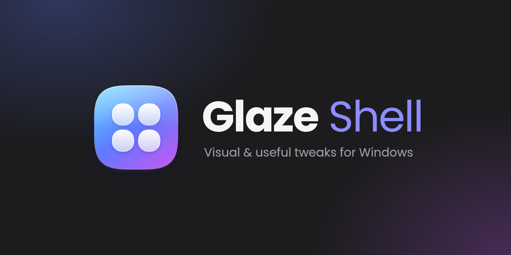
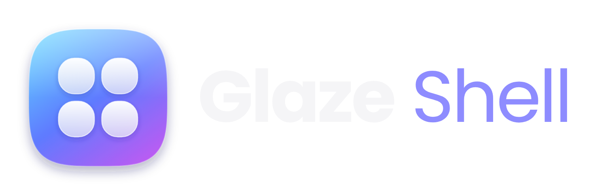

<p align="center">
  
</p>

<p align="center">
  
</p>

<h1 align="center">Glaze Shell</h1>

<p align="center">
  <a href="#требования"></a>
  <a href="#требования"></a>
  <a href="#требования"></a>
  <a href="#roadmap"></a>
</p>

Glaze Shell — Windows-приложение для глубокой персонализации рабочего окружения поверх штатных возможностей Windows. Проект не изменяет системные файлы и не заменяет компоненты Windows: он работает только через официальные Win32 и COM API.

## Описание

Glaze Shell — это оболочка рабочего стола на WinUI 3, которая собирает установленные приложения в одном месте, управляет их окнами и раскладывает рабочее пространство по вкладкам и категориям.

- **Запуск приложений.** Обнаружение через меню «Пуск» (`.lnk`) и каталог MSIX/Store, запуск, проверка состояния и вежливое закрытие.
- **Управление окнами.** Перечисление видимых окон, события окон, фокус, свернуть/развернуть/восстановить и закрытие без принудительного `kill`.
- **Мониторы и DPI.** Разрешение, refresh rate, ориентация, scale factor и реакция на изменение конфигурации дисплеев.
- **Рабочее пространство.** Вкладки, категории и раскладка приложений, которые сохраняются между запусками.
- **Темы.** Данные оформления без исполняемого кода; пользовательские темы читаются из каталога приложения.
- **Событийная модель.** Единый координатор системных событий вместо постоянного опроса.

Проект развивается поэтапно: актуальный статус — в разделе [Roadmap](#roadmap), подробные архитектурные решения — в [docs/ARCHITECTURE.md](docs/ARCHITECTURE.md).

## Быстрый старт

Для тех, у кого уже установлены [требования](#требования):

```powershell
git clone https://github.com/Cookie-Max799/Glaze-Shell.git
cd "Glaze-Shell"
dotnet run --project .\src\GlazeShell.App\GlazeShell.App.csproj
```

Первый запуск восстанавливает NuGet-пакеты и собирает проект, поэтому может занять несколько минут. В корне лежит `glaze.cmd`: двойной клик собирает и запускает приложение. Подробная инструкция — в [docs/DEVELOPMENT.md](docs/DEVELOPMENT.md).

## Возможности

### Обнаружение и запуск приложений

- обнаружение приложений меню «Пуск»: managed-парсер бинарных shortcut-файлов (MS-SHLLINK) с fallback на `IShellLinkW` и shell property store;
- обнаружение MSIX/Store-приложений через AppsFolder (`IShellItemArray`, `PKEY_AppUserModelID`);
- агрегация кандидатов, dedup по launch identity, предупреждения диагностики по каждому источнику;
- запуск: MSIX через `IApplicationActivationManager`, Win32 через `ProcessStartInfo`;
- проверка состояния и закрытие: вежливое закрытие (`CloseMainWindow`, при отсутствии главного окна — `WM_CLOSE` по top-level окнам процесса), а принудительное завершение — отдельное явное действие с подтверждением;
- перезапуск: сначала вежливое закрытие, и только если приложение не завершилось — принудительное, после чего запуск;
- UI лаунчера: поиск, список с virtualization, статус обновления, анимация запуска, клавиатурная навигация (↑/↓, Enter, Space, F5, Esc) и обновление по событиям процессов вместо периодического опроса.

### Управление окнами

- window manager: перечисление видимых top-level окон, события `WindowOpened`/`WindowClosed`/`ForegroundWindowChanged`/`WindowStateChanged` через `SetWinEventHook`, фокус с best-effort и fallback через `AttachThreadInput`, `ShowWindowAsync` и вежливое закрытие через `WM_CLOSE`;
- инлайн-панель окон в карточке запущенного приложения: заголовок, состояние, монитор окна, активное окно и кнопки «Фокус/Свернуть/Развернуть/Закрыть»;
- фильтрация окон: только видимые, не cloak-нутые (DWM `DWMWA_CLOAKED`) и не tool-windows.

### Мониторы и DPI

- перечисление мониторов (`EnumDisplayMonitors`), bounds и working area, primary-флаг, scale factor (`GetDpiForMonitor`/`GetDpiForSystem`), refresh rate и ориентация (`EnumDisplaySettingsW`);
- display events через hidden message window (`WM_DISPLAYCHANGE`, `WM_DEVICECHANGE`, `WM_SETTINGCHANGE`, `WM_DPICHANGED`) с коалесцированием пачки сигналов (`EventCoalescer`, 300 мс);
- панель «Мониторы» в футере со сводкой, списком устройств, схематичной картой (`MonitorMapLayout`) с окнами, открытыми на каждом мониторе, и автообновлением;
- пользовательские имена дисплеев: имя сохраняется в `settings.json` (`monitorNames`) и переживает перезапуск; по умолчанию — «MAIN DISPLAY» и «DISPLAY N».

### Системные события

- единый `ShellEventCoordinator` запускает оконные, дисплейные и процессовые источники и владеет их жизненным циклом; отказ одного источника не блокирует остальные;
- `ProcessEventMonitor` публикует `ProcessStarted`/`ProcessExited` по разнице снимков списка процессов (интервал по умолчанию 1 с); имя и путь читаются только для новых PID, а при отсутствии подписчиков перечисление не выполняется вовсе.

### Рабочее пространство и layout

- полный backend рабочего пространства через `DesktopManager` — вкладки, категории и приложения с каноническим `Order` на трёх уровнях и событием `DesktopChanged`;
- привязка вкладок к мониторам (`DesktopTab.MonitorId`), снятие привязок к недоступным мониторам при загрузке layout;
- UI-панель вкладок и категорий не подключена: визуальное дерево выполняет владелец проекта.

### Темы

- `ThemeManager` (набор тем, выбор действующей, событие `ThemeChanged`), встроенная тема `glaze-default`, загрузка пользовательских тем из `themes/*.json` с проверкой цветов, размеров и безопасности ассетов; тема не может содержать исполняемый код или ссылаться на файлы вне своего каталога;
- UI-применение темы не подключено: значения отдаются через `IThemeManager`, визуальное дерево — зона владельца проекта.

### Persistence

- JSON-документы пользовательских данных (`config.json`, `settings.json`, `layout.json`) с версией схемы, цепочкой миграций, атомарной записью, резервными копиями и изоляцией повреждённых документов; пути берутся только из кода.

### Application lifecycle

- одиночный экземпляр через именованный mutex (`SingleInstanceHelper`/`SingleInstanceLease`), удерживаемый весь срок работы; повторный запуск находит окно работающего экземпляра, восстанавливает его и завершает новый процесс; при закрытии окна освобождаются подписки событий, layout-writer, настройки и mutex.

### Планируемые возможности

- кастомизация рабочего стола и визуальной стороны (темы, оформление) — дизайн-система и план функций описаны в [docs/DESIGN.md](docs/DESIGN.md) и [docs/FEATURES.md](docs/FEATURES.md);
- автозапуск приложения при входе в систему;
- система виджетов и расширений — подробный перечень в [docs/FEATURES.md](docs/FEATURES.md).

## Требования

| Компонент | Версия |
| --- | --- |
| ОС | Windows 10 версии 1809 (`10.0.17763.0`) или новее |
| .NET SDK | `10.0.401` или совместимый, разрешённый `global.json` |
| Windows App SDK | `2.5.1` |
| Microsoft.Windows.SDK.BuildTools | `10.0.26100.7705` |
| Target framework | `net10.0-windows10.0.19041.0` |
| Архитектура | `x64` |

Версии NuGet-пакетов фиксируются централизованно в `Directory.Packages.props`. Подробнее — в [docs/DEVELOPMENT.md](docs/DEVELOPMENT.md).

## Структура проекта

```text
GlazeShell/
├── src/
│   ├── GlazeShell.App/            # WinUI 3 приложение (UI, композиция, точка входа)
│   ├── GlazeShell.Core/           # доменные модели, контракты, события (framework-free)
│   ├── GlazeShell.Data/           # persistence (JSON, миграции, пользовательские данные)
│   ├── GlazeShell.Infrastructure/ # логирование, пути, диагностика
│   └── GlazeShell.Windows/        # Win32/COM P/Invoke, хуки, нативные интеграции
├── tests/                         # Core.Tests, Data.Tests, Windows.Tests
├── docs/                          # архитектура, дизайн, возможности, roadmap, безопасность, разработка
├── glaze.cmd                      # скрипт быстрого запуска (сборка + запуск)
├── README.md
├── CHANGELOG.md
└── LICENSE
```

Полное дерево по слоям, конфигурационные файлы сборки и перечень Windows API — в [docs/ARCHITECTURE.md](docs/ARCHITECTURE.md).

## Roadmap

Статусы: ✅ — завершено, ⏳ — планируется.

| № | Стадия | Статус |
| --- | --- | --- |
| 0 | Foundation — структура решения, сборка, логирование и базовая конфигурация | ✅ |
| 1 | Core — доменные модели, интерфейсы и события | ✅ |
| 2 | Application Discovery — обнаружение установленных приложений | ✅ |
| 3 | Application Launcher — запуск, проверка состояния и закрытие приложений | ✅ |
| 4 | Window Manager — управление окнами и события окон | ✅ |
| 5 | Desktop Integration — мониторы, DPI и display configuration | ✅ |
| 6 | Tabs and Categories — вкладки, категории, размещение приложений и порядок элементов | ✅ |
| 7 | Persistence — JSON, layout, settings, schema migrations и recovery | ✅ |
| 8 | Theme System — безопасная загрузка данных тем без исполняемого кода | ✅ |
| 9 | Windows Events — централизованная event-driven модель | ✅ |
| 10 | Application Lifecycle — startup, shutdown и single-instance | ✅ |
| 11 | Performance — profiling и оптимизация фоновых ресурсов | ⏳ |
| 12 | Security — security review и hardening boundaries | ⏳ |
| 13 | Testing и Release — расширенное покрытие и первый релиз | ⏳ |

Текущий этап — **Stage 10 завершён**; впереди Performance (11), Security (12) и Testing/Release (13). Подробный статус по стадиям и продуктовые фазы — в [docs/ROADMAP.md](docs/ROADMAP.md).

## Документация

- [docs/DEVELOPMENT.md](docs/DEVELOPMENT.md) — сборка, запуск, тестирование, отладка и известные ограничения.
- [docs/ARCHITECTURE.md](docs/ARCHITECTURE.md) — слои, решения по стадиям, использованные Windows API и производительность.
- [docs/ROADMAP.md](docs/ROADMAP.md) — технические стадии и продуктовые фазы.
- [docs/DESIGN.md](docs/DESIGN.md) — дизайн-система Glaze Shell (цвета, материалы, компоненты, движение).
- [docs/FEATURES.md](docs/FEATURES.md) — спецификация будущих возможностей (приоритеты, фазы, критерии готовности).
- [docs/SECURITY.md](docs/SECURITY.md) — модель угроз, границы доверия и принятые риски.
- [CHANGELOG.md](CHANGELOG.md) — история изменений.

## Лицензия

Проект распространяется под лицензией MIT — полный текст в файле [LICENSE](LICENSE).
