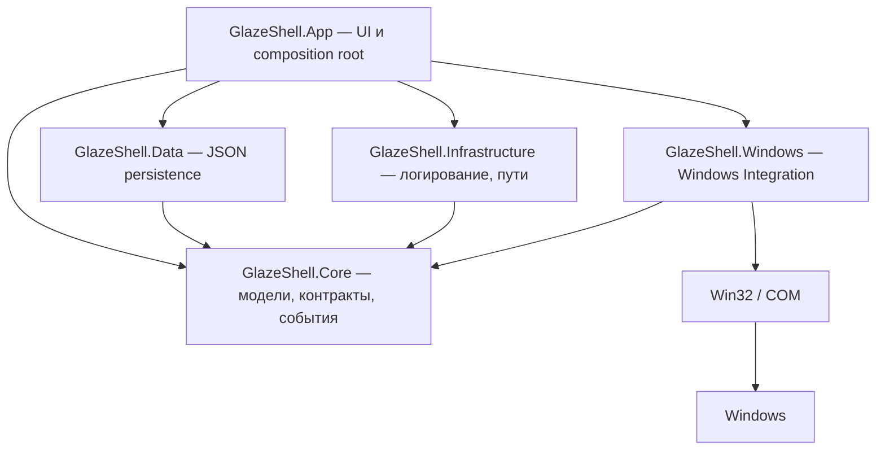

<p align="center">
  <picture>
    <source media="(prefers-color-scheme: dark)" srcset="docs/assets/banner-dark.png">
    <source media="(prefers-color-scheme: light)" srcset="docs/assets/banner-light.png">
    
  </picture>
</p>

<p align="center">
  <picture>
    <source media="(prefers-color-scheme: dark)" srcset="docs/assets/logo-dark.png">
    <source media="(prefers-color-scheme: light)" srcset="docs/assets/logo-light.png">
    
  </picture>
</p>

<h1 align="center">Glaze Shell</h1>

<p align="center">
  <a href="#требования"></a>
  <a href="#требования"></a>
  <a href="#требования"></a>
  <a href="#roadmap"></a>
</p>

Glaze Shell — Windows-приложение для глубокой персонализации рабочего окружения поверх штатных возможностей Windows. Проект не изменяет системные файлы и не заменяет компоненты Windows: он работает только через официальные Win32 и COM API.

## Описание

Glaze Shell — это оболочка рабочего стола на WinUI 3, которая собирает установленные приложения в одном месте, управляет их окнами и раскладывает рабочее пространство по вкладкам и категориям.

- **Запуск приложений.** Обнаружение через меню «Пуск» (`.lnk`) и каталог MSIX/Store, запуск, проверка состояния и вежливое закрытие.
- **Управление окнами.** Перечисление видимых окон, события окон, фокус, свернуть/развернуть/восстановить и закрытие без принудительного `kill`.
- **Мониторы и DPI.** Разрешение, refresh rate, ориентация, scale factor и реакция на изменение конфигурации дисплеев.
- **Рабочее пространство.** Вкладки, категории и раскладка приложений, которые сохраняются между запусками.
- **Темы.** Данные оформления без исполняемого кода; пользовательские темы читаются из каталога приложения.
- **Событийная модель.** Единый координатор системных событий вместо постоянного опроса.

Проект развивается поэтапно: актуальный статус — в разделе [Roadmap](#roadmap), подробные архитектурные решения — в [docs/ARCHITECTURE.md](docs/ARCHITECTURE.md).

## Скриншоты

> Скриншоты и короткая демонстрация будут добавлены позже. Секция зарезервирована под них; брендовые изображения проекта уже лежат в `docs/assets`.

<!-- Когда изображения будут готовы, замените блок ниже:

| Главное окно | Панель мониторов |
| --- | --- |
|  |  |
-->

## Оглавление

- [Описание](#описание)
- [Скриншоты](#скриншоты)
- [Быстрый старт](#быстрый-старт)
- [Возможности](#возможности)
- [Дизайн-система](#дизайн-система)
- [Архитектура](#архитектура)
- [Структура проекта](#структура-проекта)
- [Требования](#требования)
- [Установка и запуск](#установка-и-запуск)
- [Тестирование](#тестирование)
- [Разработка](#разработка)
- [Документация](#документация)
- [Roadmap](#roadmap)
- [Known issues](#known-issues)
- [Лицензия](#лицензия)

## Быстрый старт

Для тех, у кого уже установлены [требования](#требования):

```powershell
git clone https://github.com/Cookie-Max799/Glaze-Shell.git
cd "Glaze-Shell"
dotnet run --project .\src\GlazeShell.App\GlazeShell.App.csproj
```

Первый запуск восстанавливает NuGet-пакеты и собирает проект, поэтому может занять несколько минут. Подробная инструкция — ниже.

### Скрипт быстрого запуска

В корне репозитория лежит `glaze.cmd`: двойной клик по нему собирает и запускает приложение (консоль закрывается, приложение продолжает работать). Конфигурация по умолчанию — `Debug`, можно передать `Release`:

```text
glaze.cmd
glaze.cmd Release
```

## Возможности

### Обнаружение и запуск приложений

- обнаружение приложений меню «Пуск»: managed-парсер бинарных shortcut-файлов (MS-SHLLINK) с fallback на `IShellLinkW` и shell property store;
- обнаружение MSIX/Store-приложений через AppsFolder (`IShellItemArray`, `PKEY_AppUserModelID`);
- агрегация кандидатов, dedup по launch identity, предупреждения диагностики по каждому источнику;
- запуск: MSIX через `IApplicationActivationManager`, Win32 через `ProcessStartInfo`;
- проверка состояния и закрытие: вежливое закрытие (`CloseMainWindow`, при отсутствии главного окна — `WM_CLOSE` по top-level окнам процесса), а принудительное завершение — отдельное явное действие с подтверждением (`Process.Kill(entireProcessTree: true)` плюс добивание фоновых процессов из несистемного каталога установки); MSIX-пакет определяется по каталогу установки, извлечённому из пути процесса (`WindowsApps\<PackageFullName>`);
- перезапуск: сначала вежливое закрытие, и только если приложение не завершилось — принудительное, после чего запуск; это исключает второй экземпляр рядом с незакрытым первым;
- UI лаунчера: поиск, список с virtualization, статус выполнения с отметкой времени обновления, анимация запуска (круговой индикатор на карточке), клавиатурная навигация (↑/↓, Enter, Space, F5, Esc) с поднесением выбранного элемента к видимой области, яркое выделение выбранной карточки с акцентной полосой, обновление по событиям процессов вместо периодического опроса фоновых процессов.

### Управление окнами

- window manager: перечисление видимых top-level окон, события `WindowOpened`/`WindowClosed`/`ForegroundWindowChanged`/`WindowStateChanged` через `SetWinEventHook`, фокус с best-effort и fallback через `AttachThreadInput`, `ShowWindowAsync` (свернуть/развернуть/восстановить) и вежливое закрытие через `WM_CLOSE`;
- инлайн-панель окон в карточке запущенного приложения: заголовок, состояние, монитор окна, активное окно и кнопки «Фокус/Свернуть/Развернуть/Закрыть»; Win32-окна сопоставляются по пути исполняемого файла, MSIX — по имени семейства пакета;
- фильтрация окон: только видимые, не cloak-нутые (DWM `DWMWA_CLOAKED`) и не tool-windows.

### Мониторы и DPI

- monitor/DPI integration: перечисление мониторов (`EnumDisplayMonitors`), bounds и working area, primary-флаг, scale factor (`GetDpiForMonitor`/`GetDpiForSystem`), refresh rate и ориентация (`EnumDisplaySettingsW`), `MonitorFromWindow`/`MonitorFromPoint`;
- display events: уведомление об изменении конфигурации дисплеев через hidden message window (`WM_DISPLAYCHANGE`, `WM_DEVICECHANGE`/`DBT_DEVNODES_CHANGED`, `WM_SETTINGCHANGE`/`SPI_SETWORKAREA` и `SPI_SETLOGICALDPIOVERRIDE`, `WM_DPICHANGED`) и публикация `DisplayChanged`; отбор сообщений вынесен в `DisplaySignal`, а пачка сигналов объединяется `EventCoalescer` (300 мс) вместо перечисления мониторов на каждое сообщение;
- панель «Мониторы» в футере UI со сводкой, списком устройств (разрешение, DPI, refresh rate, ориентация), схематичной картой мониторов (раскладка `MonitorMapLayout`) с окнами, открытыми на каждом мониторе, и автообновлением по display events.
- пользовательские имена дисплеев: монитор можно переименовать из панели «Мониторы» (диалог «Сохранить»/«Сбросить»/«Отмена»); имя сохраняется в `settings.json` (`monitorNames`) и восстанавливается при следующем запуске. По умолчанию — «MAIN DISPLAY» и «DISPLAY N».

### Системные события

- windows events: единый `ShellEventCoordinator` запускает оконные, дисплейные и процессовые источники и владеет их жизненным циклом; отказ одного источника не блокирует остальные, диагностика возвращается в `ShellEventStatus` и пишется в лог;
- process events: `ProcessEventMonitor` публикует `ProcessStarted`/`ProcessExited` по разнице снимков списка процессов (интервал по умолчанию 1 с); первый снимок базовый, имя и путь читаются только для новых PID, а при отсутствии подписчиков перечисление не выполняется вовсе.

### Рабочее пространство и layout

- desktop layout: полный backend рабочего пространства через `DesktopManager` — вкладки (`CreateTab`/`RemoveTab`/`RenameTab`/`MoveTab`/`ActivateTab`), категории (`CreateCategory`/`RemoveCategory`/`RenameCategory`/`MoveCategory`) и приложения (`AddApplication`/`RemoveApplication`/`MoveApplication`, в том числе перенос между категориями); событие `DesktopChanged`; канонический `Order` нормализуется на каждом уровне, layout нормализуется при установке;
- привязка вкладок к мониторам: `DesktopTab.MonitorId`, `IDesktopManager.AssignTabToMonitor`, снятие привязок к недоступным мониторам при загрузке layout;
- UI-панель вкладок и категорий не подключена: подключение визуального дерева выполняет владелец проекта.

### Темы

- theme system: `ThemeManager` (набор тем, выбор действующей темы, событие `ThemeChanged`), встроенная тема `glaze-default`, загрузка пользовательских тем из `themes/*.json` с проверкой цветов, размеров и безопасности ассетов; тема не может содержать исполняемый код или ссылаться на файлы вне своего каталога;
- UI-применение темы не подключено: значения темы отдаются через `IThemeManager`, а визуальное дерево и resources — зона владельца проекта.

### Persistence

- persistence: JSON-документы пользовательских данных (`config.json`, `settings.json`, `layout.json`) с версией схемы, цепочкой миграций, атомарной записью, резервными копиями и изоляцией повреждённых документов; лимиты размера и глубины разбора; пути берутся только из кода.

### Application lifecycle

- application lifecycle: одиночный экземпляр через именованный mutex (`SingleInstanceHelper`/`SingleInstanceLease`), который удерживается весь срок работы; повторный запуск находит окно уже работающего экземпляра, восстанавливает его из свёрнутого состояния и завершает новый процесс. Окно сопоставляется по владеющему процессу (сравнение пути исполняемого файла), а при закрытии окна освобождаются подписки событий, layout-writer, настройки и mutex.

### Прочее

- файловое логирование в `%LOCALAPPDATA%\GlazeShell\logs`.

### Планируемые возможности

- кастомизация рабочего стола и настройка визуальной стороны (темы, оформление) — дизайн-система и план функций в стиле macOS описаны в [docs/DESIGN.md](docs/DESIGN.md) и [docs/FEATURES.md](docs/FEATURES.md);
- автозапуск приложения при входе в систему;
- будущая система виджетов и расширений; см. подробный перечень в [docs/FEATURES.md](docs/FEATURES.md).

## Архитектура

Решение разделено на слои так, чтобы пользовательские данные, системные детали и визуальный слой не смешивались. `GlazeShell.Core` не содержит native-типов и не импортирует Windows API: работа с `HWND`, `HMONITOR` и COM изолирована в `GlazeShell.Windows`, а Core обменивается строками-идентификаторами.



Дополнительно:

```text
UI → ViewModels и Application Services → Core → Interfaces → Windows Integration → Win32 / Windows API → Windows
```

Подробное описание слоёв, решений по стадиям и используемых Windows API — в [docs/ARCHITECTURE.md](docs/ARCHITECTURE.md).

## Структура проекта

```text
GlazeShell/
├── src/
│   ├── GlazeShell.App/            # WinUI 3 приложение (UI, композиция, точка входа)
│   │   └── Assets/                # иконка (app.ico) и логотипы приложения
│   ├── GlazeShell.Core/           # доменные модели, контракты, события (framework-free)
│   ├── GlazeShell.Data/           # persistence (JSON, миграции, пользовательские данные)
│   ├── GlazeShell.Infrastructure/ # логирование, пути, диагностика
│   └── GlazeShell.Windows/        # Win32/COM P/Invoke, хуки, нативные интеграции
├── tests/                         # тестовые проекты: Core.Tests, Data.Tests, Windows.Tests
├── docs/
│   ├── assets/                    # иконка, баннеры и логотипы для README/GitHub
│   ├── design/                    # токены, иконки и макеты дизайн-системы
│   ├── DESIGN.md                  # дизайн-система: цвета, материалы, компоненты, движение
│   ├── FEATURES.md                # спецификация возможностей в стиле macOS (фазы 1–3)
│   ├── features.json              # машинный индекс функций
│   ├── ARCHITECTURE.md            # слои, решения по стадиям, Windows API, производительность
│   └── SECURITY.md                # модель угроз и границы доверия
├── glaze.cmd                      # скрипт быстрого запуска (сборка + запуск)
├── README.md
├── CHANGELOG.md
└── LICENSE
```

Полное дерево по слоям и конфигурационные файлы сборки (`GlazeShell.slnx`, `global.json`, `Directory.Build.props`, `Directory.Packages.props`) — в [docs/ARCHITECTURE.md](docs/ARCHITECTURE.md). Локальные каталоги, перечисленные в `.gitignore` и не попадающие в репозиторий: `assets-src/` (исходные визуальные ассеты) и `AGENTS.md` (инструкции для агентов).

## Требования

| Компонент | Версия |
| --- | --- |
| ОС | Windows 10 версии 1809 (`10.0.17763.0`) или новее |
| .NET SDK | `10.0.401` или совместимый, разрешённый `global.json` |
| Windows App SDK | `2.5.1` |
| Microsoft.Windows.SDK.BuildTools | `10.0.26100.7705` |
| Target framework | `net10.0-windows10.0.19041.0` |
| Архитектура | `x64` |

Все версии NuGet-пакетов фиксируются централизованно в `Directory.Packages.props`; floating versions не используются.

Для полноценной разработки и отладки XAML рекомендуется Visual Studio с установленным workload **Windows application development** (включает Windows App SDK tooling и Windows 10/11 SDK).

## Установка и запуск

### 1. Предварительные требования

1. Установите [.NET SDK 10](https://dotnet.microsoft.com/download/dotnet/10.0). Проверьте установку:

   ```powershell
   dotnet --version
   ```

   В репозитории действует `global.json`, который разрешает диапазон версий (`rollForward: latestPatch`); в выводе должно быть `10.0.4xx` или совместимый SDK.

2. Установите [Git](https://git-scm.com/downloads) (для клонирования).
3. Для запуска достаточно SDK и рантайма Windows App SDK, который поставляется self-contained вместе с приложением. Visual Studio нужна только для разработки и отладки.

### 2. Клонирование

```powershell
git clone https://github.com/Cookie-Max799/Glaze-Shell.git
cd "Glaze-Shell"
```

### 3. Восстановление пакетов

```powershell
dotnet restore
```

NuGet восстанавливает `Microsoft.WindowsAppSDK` и `Microsoft.Windows.SDK.BuildTools`. Первый restore может занять несколько минут.

### 4. Сборка

```powershell
# Debug
dotnet build --configuration Debug

# Release
dotnet build --configuration Release
```

Проект приложения собирается только под `x64`: значение `AnyCPU` заменяется на `x64` автоматически. Если вы передаёте платформу явно, используйте `--arch x64`:

```powershell
dotnet build --configuration Release --arch x64
```

Ожидаемый результат — `0 warnings / 0 errors`. Проект собирается в режиме **unpackaged** (без MSIX-упаковки) с self-contained Windows App SDK.

### 5. Запуск

Самый простой способ — запуск из репозитория:

```powershell
dotnet run --project .\src\GlazeShell.App\GlazeShell.App.csproj
```

Альтернативно можно запустить собранный исполняемый файл:

```powershell
.\src\GlazeShell.App\bin\x64\Debug\net10.0-windows10.0.19041.0\win-x64\GlazeShell.exe
```

> Для Release замените `Debug` на `Release` в пути.

Из Visual Studio: откройте `GlazeShell.slnx`, выберите проект `GlazeShell.App` как стартовый, платформу `x64` и нажмите F5.

### 6. Проверка тестами

```powershell
dotnet test
```

Подробности и известные особенности — в разделе [Тестирование](#тестирование).

### 7. Данные и логи приложения

При первом запуске создаётся каталог пользовательских данных `%LOCALAPPDATA%\GlazeShell`:

```text
%LOCALAPPDATA%\GlazeShell\
├── config.json     # имя приложения и каталог данных
├── settings.json   # пользовательские настройки
├── layout.json     # вкладки, категории и раскладка
├── themes/         # пользовательские темы (*.json)
├── backups/        # резервные копии перед миграциями
├── recovery/       # изолированные повреждённые документы
└── logs/
    └── glaze-shell.log   # startup-лог и диагностика
```

Имя каталога данных задаётся полем `dataDirectoryName` в `config.json`, поэтому путь к данным задаётся пользователем без правки кода. При смене каталога лог текущей сессии остаётся в исходном каталоге.

### Устранение неполадок

| Симптом | Причина и решение |
| --- | --- |
| `dotnet run` собирает долго или зависает | Первый restore NuGet. Дождитесь завершения или запустите `dotnet restore` отдельно. |
| Ошибка о несовместимом SDK | Версия SDK вне диапазона `global.json`. Установите .NET SDK 10 (`10.0.401` или совместимый). |
| Пустой список MSIX-приложений, warning `0x800401E5` | Ограничение окружения: `IShellItemArray` AppsFolder недоступен. Классические `.lnk` из меню «Пуск» продолжают работать. |
| `.lnk` не резолвятся через COM, `IShellLinkW.Save` возвращает `0x80070002` | Известная особенность среды. Резолв идёт managed-парсером `ShellLinkData`; создание фикстур использует managed-writer. |
| Фокус окна не срабатывает | Фокусировка best-effort: Windows может отклонить `SetForegroundWindow` из-за foreground lock. Это ограничение системы, а не ошибка. |
| Второй запуск сразу завершается | Так и задумано: работает уже запущенный экземпляр, его окно поднимается, а новый процесс закрывается. Закройте существующее окно, чтобы запустить заново. |

## Тестирование

```powershell
dotnet test
dotnet test --configuration Release
```

Тестовые проекты:

- `tests/GlazeShell.Core.Tests` — модели, `EventManager`, `InMemorySettingsManager`, discovery service, `ApplicationProcessMatcher`, `DesktopManager`, `MonitorLayoutBinding`, `UserDataDirectoryName`, `ThemeManager`.
- `tests/GlazeShell.Data.Tests` — `JsonUserDataStoreTests`, `SchemaMigrationRunnerTests`, `PersistenceServicesTests`, `ThemeStoreTests`; каждый тест работает в собственном временном каталоге (`TempUserData`), который удаляется после теста.
- `tests/GlazeShell.Windows.Tests` — `ShellLinkResolverTests`, `StartMenuShortcutSourceTests`, `AppsFolderSourceTests`, `WindowsApplicationLauncherTests`, `WindowManagerTests`, `MonitorManagerTests`, `ProcessEventMonitorTests`, `ShellEventCoordinatorTests`, `SingleInstanceHelperTests`.

`Windows.Tests` использует управляемый writer `.lnk`-фикстур `ShellLinkBuilder` вместо COM `IShellLinkW.Save`, который в текущем окружении возвращает `0x80070002`.

Текущий статус: 309 tests (`Core.Tests` 165/165, `Data.Tests` 68/68, `Windows.Tests` 76/76 при изолированном запуске) в Debug и Release; build — 0 warnings / 0 errors. В общем прогоне допустим единственный провал — environment-tolerant flake `WindowManagerTests.RaisesWindowOpenedAndClosedEvents` (см. ниже); изолированный запуск `GlazeShell.Windows.Tests` даёт 76/76.

Остальные environment-tolerant тесты не падают из-за недоступных API, а завершаются `Inconclusive` с объясняющим warning: `AppsFolderSourceTests` и `MonitorManagerTests`. `WindowManagerTests.RaisesWindowOpenedAndClosedEvents` зависит от доставки `EVENT_OBJECT_DESTROY` для собственного процесса и потому чувствителен к параллелизму прогонов: таймаут ожидания события истекает, когда тестовые сборки запускаются одновременно. Поведение воспроизводится и на commit до Stage 7, то есть не связано с persistence или темами; изолированный запуск `GlazeShell.Windows.Tests` проходит стабильно.

Изолированный запуск одного проекта:

```powershell
dotnet test .\tests\GlazeShell.Windows.Tests\GlazeShell.Windows.Tests.csproj --configuration Release
```

## Разработка

### Правила кода

- Для XAML и App lifecycle используйте Visual Studio с Windows App SDK tooling; для диагностики startup проверьте лог и Output window.
- Не изменяйте generated `bin` и `obj` вручную.
- При добавлении P/Invoke сначала проверьте ownership и lifetime native handles; сам P/Invoke размещается только в `GlazeShell.Windows`.
- Core-модели и события добавляются в `src/GlazeShell.Core`; не помещайте туда UI, Win32 или инфраструктурные зависимости.
- Новые сервисы Core возвращают `IDisposable`, если удерживают подписки или ресурсы.
- Package versions задаются централизованно в `Directory.Packages.props`; floating versions не добавляются. Перед добавлением dependency фиксируются назначение, лицензия, размер, влияние на startup и альтернатива BCL/Windows API. MSTest используется только для автоматического тестирования.

### Git workflow

1. Проверить `git status` и текущую ветку.
2. Изучить существующие изменения и документацию.
3. Реализовать одну логически завершённую задачу.
4. Добавить тесты и обновить документацию.
5. Выполнить build и tests.
6. Проверить diff.
7. Создать отдельный commit в стиле проекта.

Сообщения коммитов пишутся на русском языке в свободной форме — это фактический стиль истории проекта (см. `git log`). Release workflow появится на Stage 13; до его утверждения нельзя публиковать installer или собранные binaries как релиз.

## Документация

- [docs/DESIGN.md](docs/DESIGN.md) — дизайн-система Glaze Shell (цвета, материалы, компоненты, движение).
- [docs/FEATURES.md](docs/FEATURES.md) — спецификация возможностей в стиле macOS для Windows (приоритеты, фазы, детальные спецификации).
- [docs/ARCHITECTURE.md](docs/ARCHITECTURE.md) — слои, dependency flow, решения по этапам, использованные Windows API и производительность.
- [docs/SECURITY.md](docs/SECURITY.md) — модель угроз, границы доверия и принятые риски.
- [CHANGELOG.md](CHANGELOG.md) — история изменений.

## Roadmap

Статусы: ✅ — завершено, ⏳ — планируется.

| № | Стадия | Статус |
| --- | --- | --- |
| 0 | Foundation — структура решения, сборка, логирование и базовая конфигурация | ✅ |
| 1 | Core — доменные модели, интерфейсы и события | ✅ |
| 2 | Application Discovery — обнаружение установленных приложений | ✅ |
| 3 | Application Launcher — запуск, проверка состояния и закрытие приложений | ✅ |
| 4 | Window Manager — управление окнами и события окон | ✅ |
| 5 | Desktop Integration — мониторы, DPI и display configuration | ✅ |
| 6 | Tabs and Categories — вкладки, категории, размещение приложений и порядок элементов | ✅ |
| 7 | Persistence — JSON, layout, settings, schema migrations и recovery. Включает привязку desktop layout к мониторам | ✅ |
| 8 | Theme System — безопасная загрузка данных тем без исполняемого кода | ✅ |
| 9 | Windows Events — централизованная event-driven модель | ✅ |
| 10 | Application Lifecycle — startup, shutdown и single-instance | ✅ |
| 11 | Performance — profiling и оптимизация фоновых ресурсов | ⏳ |
| 12 | Security — security review и hardening boundaries | ⏳ |
| 13 | Testing и Release — расширенное покрытие и первый релиз | ⏳ |

### Текущий статус по стадиям

- **Stage 10 — Application Lifecycle завершён.** Реализован единый жизненный цикл экземпляра приложения: одиночность запуска через именованный mutex, который удерживается весь срок работы (`SingleInstanceLease`), а повторный запуск находит окно уже работающего экземпляра, поднимает его и завершает новый процесс. При закрытии окна освобождаются layout-writer, источники событий и сам mutex (последним), поэтому экземпляр можно запустить заново; окно, созданное другим процессом, сопоставляется по владеющему процессу, а не по пути модуля.
- **Stage 9 — Windows Events завершён.** Источники системных событий запускаются из одной точки (`ShellEventCoordinator`): оконные события (`SetWinEventHook`), события дисплеев (hidden message window) и события процессов (`ProcessEventMonitor`). Отказ отдельного источника не прерывает запуск остальных — диагностика попадает в `ShellEventStatus.Diagnostics` и лог, а `Start()` возвращает флаг по каждому источнику. Состояние запущенных приложений обновляется по событиям `ProcessStarted`/`ProcessExited` вместо опроса каждые 3 секунды, а пачка событий одного запуска объединяется вместо пересчёта на каждое событие.
- **Stage 8 — Theme System завершён.** Реализован backend тем: `ThemeManager` хранит набор тем, выбирает действующую тему (по `UserSettings.ActiveThemeId`) и публикует `ThemeChanged`; `ThemeStore` читает пользовательские темы из каталога `themes` в каталоге данных приложения. Тема содержит только данные оформления (`metadata`, `colors`, `fonts`, `dimensions`, `icons`, `wallpaper`, `effects`): исполняемые ассеты, пути вне каталога темы и нечисловые выражения цвета отклоняются, непригодная тема отбрасывается по отдельности и не портит остальные, а при отсутствии тем применяется встроенная тема `glaze-default`. Решение о том, как отображать значения темы, остаётся за UI.
- **Stage 7 — Persistence завершён.** Реализовано сохранение пользовательских данных в JSON (`config.json`, `settings.json`, `layout.json`): версия схемы в каждом документе, цепочка миграций с резервной копией перед перезаписью, атомарная запись, изоляция повреждённых документов в `recovery` и неприкосновенность документов из будущих версий приложения. Layout восстанавливается между запусками вместе с привязкой вкладок к мониторам: привязки к недоступным мониторам снимаются, а результат сверки сразу сохраняется. Автосохранение layout выполняет `DesktopLayoutPersistenceWriter`, объединяя частые изменения в одну запись.
- **Stage 6 — Tabs and Categories завершён.** Реализован полный backend рабочего пространства: вкладки (создание, удаление, переименование, перемещение, активация), категории (создание, удаление, переименование, перемещение) и размещение приложений (добавление, удаление, перенос между категориями) с единым каноническим порядком `Order` на трёх уровнях layout. `DesktopTab.IsActive` удалён как дублирующее поле — единственный источник активной вкладки `DesktopLayout.ActiveTabId`.
- **Stage 5 — Desktop Integration завершён.** Реализованы мониторы и DPI (перечисление, resolution, refresh rate, ориентация, scale factor, primary), display events через `WM_DISPLAYCHANGE`, desktop layout (вкладки и элементы) через `DesktopManager`; в футере отображается панель «Мониторы» с обновлением по событиям.
- **Stage 4 — Window Manager завершён.** Реализовано перечисление видимых top-level окон, события окон (открытие, закрытие, foreground, изменение состояния), фокус, свернуть/развернуть/восстановить через `ShowWindowAsync` и закрытие через `WM_CLOSE`; в карточках запущенных приложений отображается инлайн-панель их окон.
- **Stage 3 — Application Launcher завершён.** Реализованы запуск, проверка состояния и закрытие приложений (Win32 + MSIX), а также простой UI лаунчера с поиском и горячими клавишами.
- **Stage 2 — Application Discovery завершён.** Реализовано обнаружение приложений из меню «Пуск» (`.lnk`) и пакетов MSIX/AppsFolder через официальные Windows API.
- **Stage 1 — Core завершён.** Реализованы доменные модели, контракты интерфейсов, события и базовые framework-free сервисы `GlazeShell.Core`.
- **Stage 0 — Foundation завершён.** Создана минимальная запускаемая WinUI 3 оболочка, слоистая структура .NET-решения, базовая конфигурация, централизованное файловое логирование и тестовый проект.

## Продуктовый roadmap

Статусы: ✅ — завершено, ⏳ — планируется, ⚪ — не планируется.

Краткое описание фаз см. в [docs/FEATURES.md](docs/FEATURES.md); там же полная спецификация (53 функции). G1 (слой клавиатуры в стиле Mac) снят с плана.

| Фаза | Описание | Статус |
|---|---|---|
| Phase 1 (MVP) | Core identity, безопасность, top bar, dock, Glance, Quick Preview, Quick Settings, Explorer basics, настройки, доступность, мультимонитор/DPI | ⏳ |
| Phase 2 | Бейджи, папки в dock, Trash, сетка приложений, виджеты, Overview, Workspaces, Snap, app switcher, центр уведомлений, календарь, вкладки/пути Explorer, теги, Get Info, undo, недавние, скриншоты | ⏳ |
| Phase 3 | Анимация сворачивания в dock, стопки рабочего стола, динамические обои, горячие углы, скрыть/показать, force quit, режимы фокуса, HUD, пакетное переименование, spring-loaded, умные папки, быстрые действия, запись экрана, замена текста, диакритика, backdrop для чужих окон | ⏳ |
| Later | Focus layout, Share, трекпад-удобства, словарный поиск, звуковая тема | ⏳ |
| Снято с плана | G1 — слой клавиатуры в стиле Mac | ⚪ |

All product feature plans consolidated in [docs/FEATURES.md](docs/FEATURES.md) with full details and acceptance criteria.

## Продуктовый roadmap

Статусы: ✅ — завершено, ⏳ — планируется, ⚪ — не планируется.

Краткое описание фаз см. в [docs/FEATURES.md](docs/FEATURES.md); там же полная спецификация (53 функции). G1 (слой клавиатуры в стиле Mac) снят с плана.

| Фаза | Описание | Статус |
|---|---|---|
| Phase 1 (MVP) | Core identity, безопасность, top bar, dock, Glance, Quick Preview, Quick Settings, Explorer basics, настройки, доступность, мультимонитор/DPI | ⏳ |
| Phase 2 | Бейджи, папки в dock, Trash, сетка приложений, виджеты, Overview, Workspaces, Snap, app switcher, центр уведомлений, календарь, вкладки/пути Explorer, теги, Get Info, undo, недавние, скриншоты | ⏳ |
| Phase 3 | Анимация сворачивания в dock, стопки рабочего стола, динамические обои, горячие углы, скрыть/показать, force quit, режимы фокуса, HUD, пакетное переименование, spring-loaded, умные папки, быстрые действия, запись экрана, замена текста, диакритика, backdrop для чужих окон | ⏳ |
| Later | Focus layout, Share, трекпад-удобства, словарный поиск, звуковая тема | ⏳ |
| Снято с плана | G1 — слой клавиатуры в стиле Mac | ⚪ |

All product feature plans consolidated in [docs/FEATURES.md](docs/FEATURES.md) with full details and acceptance criteria.

## Known issues

- Visual Studio/WinUI 3 template не установлен в текущем окружении; App project создан вручную.
- В текущей среде `CLSID_ShellLink` зарегистрирован не в `shell32.dll`, поэтому `IShellLinkW.Load` реальных `.lnk` возвращает `0x00000001`, а `Save` — `0x80070002`. Классические `.lnk` резолвятся managed-парсером `ShellLinkData` (LinkInfo/relative path); через property store и `IShellLinkW` — в зависимости от здоровья среды.
- `IShellItemArray` AppsFolder в текущей среде возвращает `0x800401E5`, поэтому MSIX-источник может сообщить warning вместо списка приложений. Это environment-specific limitation и не считается ошибкой продукта.
- Окна MSIX-приложений сопоставляются с карточками по имени семейства пакета, извлечённому из пути процесса окна (`WindowsApps\<PackageFullName>`); каталог установки из реестра для bundle-пакетов указывает на `neutral`-вариант и для этой цели не используется. Побочный эффект: пакет с фоновым сервисом без окна показывается запущенным, пока сервис жив.
- Фокусировка окна — best-effort: при отказе `SetForegroundWindow` (foreground lock) используется fallback через `AttachThreadInput`; в окружениях с жёстким foreground lock команда может не сработать.
- Используется системный title bar, поэтому его оформление не следует тёмной палитре контента; кастомный title bar запланирован вместе с Theme System.

## Лицензия

## Дизайн-система

Дизайн Glaze Shell основан на концепции «глазурованной керамики»: мягкое стекло, пастель, крупные скругления, плавающие панели и две равноправные темы (светлая и тёмная). Подробности — в [docs/DESIGN.md](docs/DESIGN.md). Токены, иконки и эталонные макеты расположены в `docs/design/`.

Проект распространяется под лицензией MIT — полный текст в файле [LICENSE](LICENSE).
