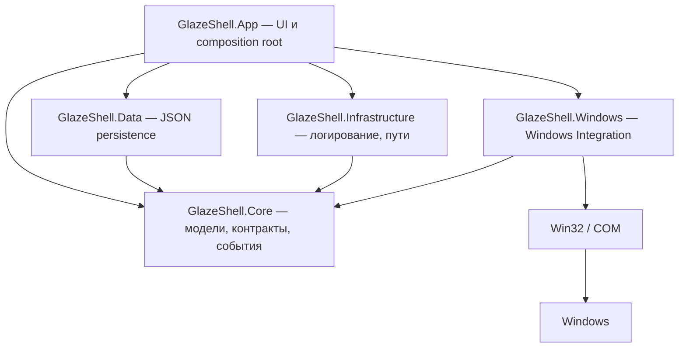

<p align="center">
  <picture>
    <source media="(prefers-color-scheme: dark)" srcset="docs/assets/banner-dark.png">
    <source media="(prefers-color-scheme: light)" srcset="docs/assets/banner-light.png">
    
  </picture>
</p>

<p align="center">
  <picture>
    <source media="(prefers-color-scheme: dark)" srcset="docs/assets/logo-dark.png">
    <source media="(prefers-color-scheme: light)" srcset="docs/assets/logo-light.png">
    
  </picture>
</p>

<h1 align="center">Glaze Shell</h1>

<p align="center">
  <a href="#требования"></a>
  <a href="#требования"></a>
  <a href="#требования"></a>
  <a href="docs/ROADMAP.md"></a>
</p>

<p align="center">
  <a href="docs/USAGE.md"></a>
  <a href="docs/DEVELOPMENT.md"></a>
  <a href="docs/ARCHITECTURE.md"></a>
  <a href="docs/ROADMAP.md"></a>
  <a href="docs/FEATURES.md"></a>
</p>

<p align="center">
  <a href="docs/DESIGN.md"></a>
  <a href="docs/SECURITY.md"></a>
  <a href="docs/RELEASE.md"></a>
  <a href="CHANGELOG.md"></a>
  <a href="LICENSE"></a>
</p>

Glaze Shell — Windows-приложение для глубокой персонализации рабочего окружения поверх штатных возможностей Windows. Проект не изменяет системные файлы и не заменяет компоненты Windows: он работает только через официальные Win32 и COM API.

## О проекте

Glaze Shell — оболочка рабочего стола на **WinUI 3** (.NET 10, Windows App SDK 2.5.1). Идея — собрать привычные системные действия (запуск приложений, управление окнами, работа с мониторами) в одном быстром интерфейсе и постепенно превратить его в цельную оболочку в духе macOS, оставаясь на стороне штатных механизмов Windows.

Инженерный фундамент доведён до **MVP**: приложение собирает установленные приложения в одном месте, управляет их окнами, показывает мониторы и DPI и сохраняет рабочее пространство между запусками.

**Принципы проекта:**

- только официальные Win32/COM API — никакого патчинга системы, реестра и системных файлов;
- строгое разделение слоёв: доменная логика не знает о native-типах и UI;
- event-driven вместо polling: системные события доставляются подпискам, а не опрашиваются по таймеру;
- безопасность по умолчанию: темы — только данные, чтение файлов ограничено лимитами, логи редактируются.

## Возможности

Кратко; полное описание каждой возможности — в [docs/USAGE.md](docs/USAGE.md).

- **Обнаружение приложений.** Меню «Пуск» (`.lnk` через managed-парсер MS-SHLLINK) и MSIX/Store (AppsFolder через shell property store).
- **Запуск и состояние.** Запуск Win32 и MSIX, проверка состояния, вежливое закрытие, перезапуск и принудительное завершение с подтверждением.
- **Управление окнами.** Перечисление видимых топ-левел окон, события окон, фокус, свернуть/развернуть/восстановить, закрытие через `WM_CLOSE`.
- **Мониторы и DPI.** Перечисление мониторов, разрешение, refresh rate, ориентация, scale factor, схематичная карта раскладки и пользовательские имена дисплеев.
- **Рабочее пространство.** Вкладки, категории и раскладка приложений с сохранением между запусками и привязкой к мониторам (backend).
- **Темы.** Переключатель оформления в приложении: режим (Системная/Светлая/Тёмная) и шесть акцентных цветов, применяемые мгновенно; плюс безопасная система данных тем без исполняемого кода (`ThemeManager`/`ThemeStore`).
- **Верхняя панель.** Плавающая верхняя панель (базовый слайс A6): активное приложение с шевроном и расположением, строка поиска с подсказкой `Ctrl K`, статус (сеть, громкость, батарея) и часы с датой — три стеклянных pill, вырезанных из окна по своим границам, topmost и без кражи фокуса; включается из шапки.
- **Глобальный поиск Glance (B1).** `Ctrl K` в любом приложении открывает поиск в верхней панели: приложения, открытые окна, страницы настроек и команды Glaze Shell ранжируются и показываются в стеклянной панели под строкой поиска (`Enter` — открыть, `Esc` — закрыть). Поиск по файлам и калькулятор — следующие шаги.
- **Центр управления (D1).** Клик по правому pill открывает стеклянный popover с реальной громкостью устройства вывода (Core Audio: ползунок 0–100 и «без звука»), выбором режима оформления и ссылками на системные настройки (Сеть, Bluetooth, Звук). Громкость обновляется раз в секунду, пока popover открыт; Wi-Fi/Bluetooth/яркость — следующие шаги.
- **Проводник (E1/E2).** Отдельное окно файлового менеджера (кнопка «Проводник» в шапке и команда Glance `open-explorer`): сайдбар с системными папками, пользовательским избранным и дисками с индикатором заполнения; два вида — иконки (сетка с шелл-иконками) и список (колонки Имя/Изменён/Размер); сортировка по имени, дате, размеру и типу в обе стороны (папки всегда первые); навигация назад/вперёд/выше, `Enter` открывает папку. Избранное и вид сохраняются в `settings.json` (`explorerFavorites`, `explorerViewMode`). Колонки Миллера, галерея, вкладки и теги — следующие шаги.
- **Quick Preview (B2).** Пробел на выбранном элементе проводника (или кнопка «Предпросмотр») открывает карточку предпросмотра: картинки декодируются WinUI, текст и код читаются в фоне с распознаванием кодировки и обрезкой по лимиту, папка — сводкой по числу элементов, остальное — метаданными и кнопкой «Открыть». Файл открывается на чтение с общим доступом и никогда не блокируется; `Esc` или пробел закрывают карточку. PDF/Office, зум и «Открыть с помощью» — следующие шаги.
- **Dock.** Стеклянный dock-капсула внизу (базовый слайс A1), прижатая к нижнему краю экрана и растворяющаяся в нём: «Пуск», закреплённые и запущенные приложения с индикатором, папка «Загрузки» и корзина, контекстное меню для закрепления и непрерывная магнификация плиток вокруг курсора (до 15 px/1.2) по DESIGN. Может заменять системную панель задач: она скрывается, пока работает dock, и восстанавливается при выходе или выключении.
- **Событийная модель.** Единый координатор системных событий (`ShellEventCoordinator`) вместо постоянного опроса.
- **Персистентность.** JSON-документы с версией схемы, миграциями, атомарной записью, резервными копиями и recovery.
- **Один экземпляр.** Single-instance через именованный mutex и корректное освобождение ресурсов при закрытии.

## Как пользоваться приложением

Коротко; полная инструкция — в [docs/USAGE.md](docs/USAGE.md).

- Поиск фильтрует приложения по названию, пути или AUMID; `F5` обновляет список.
- Действия над выбранной карточкой: **Запустить**, **Закрыть**, **Перезапустить**, **Завершить принудительно**.
- Клавиатура: `↑`/`↓` — навигация, `Enter`/`Space` — запуск, `Esc` — очистить поиск.
- `Ctrl K` в любом приложении фокусирует поиск Glance в верхней панели; стрелки двигают выбор, `Enter` открывает, `Esc` закрывает.
- Клик по правому pill верхней панели открывает «Центр управления»: ползунок громкости, «без звука», выбор темы оформления и ссылки на настройки Сети, Bluetooth и Звука. Клик мимо закрывает popover.
- Кнопка «Проводник» в шапке (или команда `open-explorer` в Glance) открывает проводник: системные папки, избранное и диски слева, сортировка по колонкам, `Enter` открывает папку, «В избранное» сохраняет путь.
- `Пробел` на выбранном элементе проводника (или кнопка «Предпросмотр») показывает карточку Quick Preview: картинка, текст, сводка папки или метаданные; `Esc` или пробел закрывают, «Открыть» запускает файл в приложении по умолчанию.
- Панель «Мониторы» справа: сводка, карта раскладки, окна на каждом дисплее и переименование дисплея.
- Переключатели в шапке задают тему (Системная/Светлая/Тёмная) и акцентный цвет, включают верхнюю панель (Top bar) и dock; выбор сохраняется.
- Dock снизу показывает закреплённые и запущенные приложения, папку «Загрузки» и корзину: клик запускает или переключает приложение, повторный клик по активному — сворачивает, правый клик закрепляет или открепляет. Переключатель «Вместо панели задач» скрывает системную панель задач, пока dock включён.

## Статус проекта

| Параметр | Значение |
| --- | --- |
| Версия | `0.1.0` (единый источник — `Directory.Build.props`) |
| Стадии | Stage 0–13 ✅ — инженерный фундамент завершён |
| Тесты | 568 (`Core.Tests` 306, `Data.Tests` 146, `Windows.Tests` 116) |
| Сборка | Debug и Release — 0 warnings / 0 errors |
| Распространение | unpackaged; Installer, MSIX и подпись — позже |
| Лицензия | MIT |

## Быстрый старт

Для тех, у кого уже установлены [требования](#требования):

```powershell
git clone https://github.com/Cookie-Max799/Glaze-Shell.git
cd "Glaze-Shell"
dotnet run --project .\src\GlazeShell.App\GlazeShell.App.csproj
```

Первый запуск восстанавливает NuGet-пакеты и собирает проект, поэтому может занять несколько минут. В корне репозитория лежит `glaze.cmd`: двойной клик собирает и запускает приложение (можно передать `Release`). Полная инструкция — в [docs/DEVELOPMENT.md](docs/DEVELOPMENT.md).

## Тестирование

```powershell
dotnet test
dotnet test --configuration Release
```

Три тестовых проекта: `GlazeShell.Core.Tests`, `GlazeShell.Data.Tests`, `GlazeShell.Windows.Tests`. Подробности, известные environment-specific особенности и изолированный запуск — в [docs/DEVELOPMENT.md](docs/DEVELOPMENT.md).

## Архитектура

Решение разделено на слои так, чтобы пользовательские данные, системные детали и визуальный слой не смешивались. `GlazeShell.Core` не содержит native-типов и не импортирует Windows API: работа с `HWND`, `HMONITOR` и COM изолирована в `GlazeShell.Windows`, а Core обменивается строками-идентификаторами.



Подробнее — в [docs/ARCHITECTURE.md](docs/ARCHITECTURE.md): слои, решения по стадиям, использованные Windows API и производительность.

## Структура проекта

```text
GlazeShell/
├── src/
│   ├── GlazeShell.App/            # WinUI 3 приложение (UI, композиция, точка входа)
│   ├── GlazeShell.Core/           # доменные модели, контракты, события (framework-free)
│   ├── GlazeShell.Data/           # persistence (JSON, миграции, пользовательские данные)
│   ├── GlazeShell.Infrastructure/ # логирование, пути, диагностика
│   └── GlazeShell.Windows/        # Win32/COM P/Invoke, хуки, нативные интеграции
├── tests/                         # Core.Tests, Data.Tests, Windows.Tests
├── docs/                          # использование, разработка, архитектура, roadmap, дизайн, безопасность, релиз
├── glaze.cmd                      # скрипт быстрого запуска (сборка + запуск)
├── README.md
├── CHANGELOG.md
└── LICENSE
```

Полное дерево по слоям и конфигурационные файлы сборки (`GlazeShell.slnx`, `global.json`, `Directory.Build.props`, `Directory.Packages.props`) — в [docs/ARCHITECTURE.md](docs/ARCHITECTURE.md).

## Требования

| Компонент | Версия |
| --- | --- |
| ОС | Windows 10 версии 1809 (`10.0.17763.0`) или новее |
| .NET SDK | `10.0.401` или совместимый, разрешённый `global.json` |
| Windows App SDK | `2.5.1` |
| Target framework | `net10.0-windows10.0.19041.0` |
| Архитектура | `x64` |

Полная таблица зависимостей и заметки про Visual Studio — в [docs/DEVELOPMENT.md](docs/DEVELOPMENT.md).

## Документация

- [docs/USAGE.md](docs/USAGE.md) — возможности MVP и инструкция по использованию приложения.
- [docs/DEVELOPMENT.md](docs/DEVELOPMENT.md) — установка, сборка, запуск, тестирование, отладка и известные ограничения.
- [docs/ARCHITECTURE.md](docs/ARCHITECTURE.md) — слои, решения по стадиям, использованные Windows API и производительность.
- [docs/ROADMAP.md](docs/ROADMAP.md) — технические стадии 0–13 и продуктовые фазы.
- [docs/FEATURES.md](docs/FEATURES.md) — спецификация будущих возможностей (приоритеты, фазы, критерии готовности).
- [docs/DESIGN.md](docs/DESIGN.md) — дизайн-система Glaze Shell (цвета, материалы, компоненты, движение).
- [docs/SECURITY.md](docs/SECURITY.md) — модель угроз, границы доверия и принятые риски.
- [docs/RELEASE.md](docs/RELEASE.md) — версионирование, процесс и чеклист релиза.
- [CHANGELOG.md](CHANGELOG.md) — история изменений.

## Roadmap

Статусы: ✅ — завершено, ⏳ — планируется.

| Веха | Стадии | Статус |
| --- | --- | --- |
| Фундамент оболочки (core, discovery, launcher, окна, мониторы, layout, persistence, темы, события, lifecycle) | 0–10 | ✅ |
| Hardening фундамента (Performance, Security) | 11–12 | ✅ |
| Testing и Release | 13 | ✅ |
| Продуктовый UI (Phase 1–3: dock, top bar, Glance и др.) | следующие | ⏳ |
| Продуктовый UI — Phase 1 начата: H1 «Движок тем» (режим и акцент); A6 «Top bar», A1 «Dock», B1 «Glance», D1 «Центр управления», E1/E2 «Проводник» и B2 «Quick Preview» (базовые слайсы) | Phase 1 | ✅ |

Полная таблица стадий, статус по каждой из них и продуктовые фазы — в [docs/ROADMAP.md](docs/ROADMAP.md).

## Ограничения

- Панель вкладок и категорий и пользовательские темы (`themes/*.json`) пока не подключены к UI — backend готов и покрыт тестами, визуальная часть впереди. Встроенная тема (режим и акцент) уже применяется к интерфейсу.
- Dock — базовый слайс: одна панель на основном мониторе, без перетаскивания плиток, бейджей, стопок папок, popover-карточки папки и анимации сворачивания окон. Скрытие системной панели задач обратимо и не меняет настройки Windows, но при аварийном завершении приложения панель возвращается при следующем запуске или перезапуске Explorer.
- Glance (глобальный поиск) — базовый слайс: приложения, открытые окна, страницы настроек и команды Glaze Shell. Нет поиска по файлам (индекс Windows Search), калькулятора и конвертаций, истории буфера и веб-fallback; результаты выводятся без иконок приложений; `Ctrl K` не работает, если комбинацию заняла другая программа.
- «Центр управления» (D1) — базовый слайс: реальная громкость, режим оформления и ссылки на системные настройки. Переключатели Wi-Fi/Bluetooth/авиарежима (WinRT-радио требует упаковки Windows), яркость (WMI/DDC-CI), «Ночной свет» и «Фокус» не реализованы; «Тёмная тема» меняет оформление Glaze Shell, а не системную тему Windows.
- «Проводник» (E1/E2) — базовый слайс: два вида (иконки и список), сортировка, навигация, системные папки, избранное и диски. Колонки Миллера и галерея, миниатюры с дисковым кэшем, виртуализация огромных каталогов, вкладки и строка пути (E3), теги (E4), Get Info (E5), перетаскивание папок в сайдбар и извлечение съёмных дисков не реализованы; скрытые и системные элементы в списках не показываются.
- Quick Preview (B2) — базовый слайс: картинки, текст/код, сводка папки и метаданные остального. Нет предпросмотра PDF/Office (`IPreviewHandler`), проигрывания аудио/видео, зума, «Открыть с помощью», навигации по выборке стрелками и предпросмотра в стандартном проводнике Windows; текст в UTF-16 без BOM распознаётся как двоичный.
- Приложение поставляется как unpackaged: Installer, MSIX и подпись появятся позже.
- Скриншоты и короткая демонстрация будут добавлены позже; брендовые изображения уже лежат в `docs/assets`.

## Лицензия

Проект распространяется под лицензией **MIT** — полный текст в файле [LICENSE](LICENSE).
