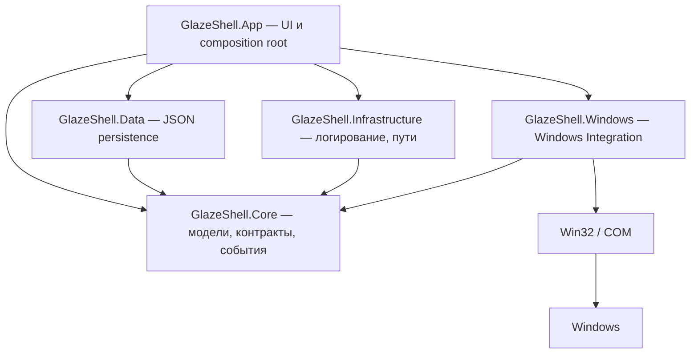

<p align="center">
  <picture>
    <source media="(prefers-color-scheme: dark)" srcset="docs/assets/banner-dark.png">
    <source media="(prefers-color-scheme: light)" srcset="docs/assets/banner-light.png">
    
  </picture>
</p>

<p align="center">
  <picture>
    <source media="(prefers-color-scheme: dark)" srcset="docs/assets/logo-dark.png">
    <source media="(prefers-color-scheme: light)" srcset="docs/assets/logo-light.png">
    
  </picture>
</p>

<h1 align="center">Glaze Shell</h1>

<p align="center">
  <a href="#требования"></a>
  <a href="#требования"></a>
  <a href="#требования"></a>
  <a href="docs/ROADMAP.md"></a>
</p>

Glaze Shell — Windows-приложение для глубокой персонализации рабочего окружения поверх штатных возможностей Windows. Проект не изменяет системные файлы и не заменяет компоненты Windows: он работает только через официальные Win32 и COM API.

## Описание

Glaze Shell — оболочка рабочего стола на WinUI 3. Инженерный фундамент доведён до **MVP**: приложение собирает установленные приложения в одном месте, управляет их окнами, показывает мониторы и DPI и сохраняет рабочее пространство между запусками.

- **Запуск приложений.** Обнаружение через меню «Пуск» (`.lnk`) и каталог MSIX/Store, запуск, проверка состояния и вежливое закрытие.
- **Управление окнами.** Перечисление видимых окон, события окон, фокус, свернуть/развернуть/восстановить и закрытие без принудительного `kill`.
- **Мониторы и DPI.** Разрешение, refresh rate, ориентация, scale factor и реакция на изменение конфигурации дисплеев.
- **Рабочее пространство.** Вкладки, категории и раскладка приложений, которые сохраняются между запусками.
- **Темы.** Данные оформления без исполняемого кода; пользовательские темы читаются из каталога приложения.
- **Событийная модель.** Единый координатор системных событий вместо постоянного опроса.

> **Статус: MVP достигнут (Stage 0–13).** Полная дорожная карта — в [docs/ROADMAP.md](docs/ROADMAP.md). Продуктовый UI (dock, top bar, Glance и др.) — следующие стадии; см. [docs/FEATURES.md](docs/FEATURES.md).

## Быстрый старт

Для тех, у кого уже установлены [требования](#требования):

```powershell
git clone https://github.com/Cookie-Max799/Glaze-Shell.git
cd "Glaze-Shell"
dotnet run --project .\src\GlazeShell.App\GlazeShell.App.csproj
```

Первый запуск восстанавливает NuGet-пакеты и собирает проект, поэтому может занять несколько минут. В корне репозитория лежит `glaze.cmd`: двойной клик собирает и запускает приложение (можно передать `Release`). Подробная инструкция — в [docs/DEVELOPMENT.md](docs/DEVELOPMENT.md).

## Возможности

Кратко; полное описание каждой возможности — в [docs/USAGE.md](docs/USAGE.md).

- Обнаружение приложений из меню «Пуск» (`.lnk` через managed-парсер MS-SHLLINK) и MSIX/Store (AppsFolder).
- Запуск, проверка состояния, вежливое закрытие, перезапуск и принудительное завершение с подтверждением.
- Перечисление видимых окон, события окон, фокус, свернуть/развернуть/восстановить, закрытие через `WM_CLOSE`.
- Мониторы и DPI: перечисление, resolution, refresh rate, ориентация, scale factor, карта раскладки, пользовательские имена дисплеев.
- Вкладки, категории и раскладка приложений с сохранением между запусками и привязкой к мониторам (backend).
- Безопасная система тем без исполняемого кода: проверка цветов, размеров и ассетов (`ThemeManager`/`ThemeStore`).
- Централизованная событийная модель (`ShellEventCoordinator`) вместо постоянного опроса.
- Персистентность JSON: версия схемы, миграции, атомарная запись, резервные копии и recovery.
- Один экземпляр приложения (single-instance через именованный mutex) и корректное освобождение ресурсов при закрытии.

## Как пользоваться приложением

Коротко; полная инструкция — в [docs/USAGE.md](docs/USAGE.md).

- Поиск фильтрует приложения по названию, пути или AUMID; `F5` обновляет список.
- Действия над выбранной карточкой: **Запустить**, **Закрыть**, **Перезапустить**, **Завершить принудительно**.
- Клавиатура: `↑`/`↓` — навигация, `Enter`/`Space` — запуск, `Esc` — очистить поиск.
- Панель «Мониторы» справа: сводка, карта раскладки, окна на каждом дисплее и переименование дисплея.

## Скриншоты

> Скриншоты и короткая демонстрация будут добавлены позже. Секция зарезервирована под них; брендовые изображения проекта уже лежат в `docs/assets`.

## Архитектура

Решение разделено на слои так, чтобы пользовательские данные, системные детали и визуальный слой не смешивались. `GlazeShell.Core` не содержит native-типов и не импортирует Windows API: работа с `HWND`, `HMONITOR` и COM изолирована в `GlazeShell.Windows`, а Core обменивается строками-идентификаторами.



Подробнее — в [docs/ARCHITECTURE.md](docs/ARCHITECTURE.md): слои, решения по стадиям, использованные Windows API и производительность.

## Структура проекта

```text
GlazeShell/
├── src/
│   ├── GlazeShell.App/            # WinUI 3 приложение (UI, композиция, точка входа)
│   ├── GlazeShell.Core/           # доменные модели, контракты, события (framework-free)
│   ├── GlazeShell.Data/           # persistence (JSON, миграции, пользовательские данные)
│   ├── GlazeShell.Infrastructure/ # логирование, пути, диагностика
│   └── GlazeShell.Windows/        # Win32/COM P/Invoke, хуки, нативные интеграции
├── tests/                         # Core.Tests, Data.Tests, Windows.Tests
├── docs/                          # использование, разработка, архитектура, roadmap, дизайн, безопасность, релиз
├── glaze.cmd                      # скрипт быстрого запуска (сборка + запуск)
├── README.md
├── CHANGELOG.md
└── LICENSE
```

Полное дерево по слоям и конфигурационные файлы сборки (`GlazeShell.slnx`, `global.json`, `Directory.Build.props`, `Directory.Packages.props`) — в [docs/ARCHITECTURE.md](docs/ARCHITECTURE.md).

## Требования

| Компонент | Версия |
| --- | --- |
| ОС | Windows 10 версии 1809 (`10.0.17763.0`) или новее |
| .NET SDK | `10.0.401` или совместимый, разрешённый `global.json` |
| Windows App SDK | `2.5.1` |
| Target framework | `net10.0-windows10.0.19041.0` |
| Архитектура | `x64` |

Полная таблица зависимостей и заметки про Visual Studio — в [docs/DEVELOPMENT.md](docs/DEVELOPMENT.md).

## Документация

- [docs/USAGE.md](docs/USAGE.md) — возможности MVP и инструкция по использованию приложения.
- [docs/DEVELOPMENT.md](docs/DEVELOPMENT.md) — установка, сборка, запуск, тестирование, отладка и известные ограничения.
- [docs/ARCHITECTURE.md](docs/ARCHITECTURE.md) — слои, решения по стадиям, использованные Windows API и производительность.
- [docs/ROADMAP.md](docs/ROADMAP.md) — технические стадии 0–13 и продуктовые фазы.
- [docs/FEATURES.md](docs/FEATURES.md) — спецификация будущих возможностей (приоритеты, фазы, критерии готовности).
- [docs/DESIGN.md](docs/DESIGN.md) — дизайн-система Glaze Shell (цвета, материалы, компоненты, движение).
- [docs/SECURITY.md](docs/SECURITY.md) — модель угроз, границы доверия и принятые риски.
- [docs/RELEASE.md](docs/RELEASE.md) — версионирование, процесс и чеклист релиза.
- [CHANGELOG.md](CHANGELOG.md) — история изменений.

## Roadmap

Статусы: ✅ — завершено, ⏳ — планируется.

| Веха | Стадии | Статус |
| --- | --- | --- |
| Фундамент оболочки (core, discovery, launcher, окна, мониторы, layout, persistence, темы, события, lifecycle) | 0–10 | ✅ |
| Hardening фундамента (Performance, Security) | 11–12 | ✅ |
| Testing и Release | 13 | ✅ |
| Продуктовый UI (Phase 1–3: dock, top bar, Glance и др.) | следующие | ⏳ |

Полная таблица стадий, статус по каждой из них и продуктовые фазы — в [docs/ROADMAP.md](docs/ROADMAP.md).

## Лицензия

Проект распространяется под лицензией MIT — полный текст в файле [LICENSE](LICENSE).
